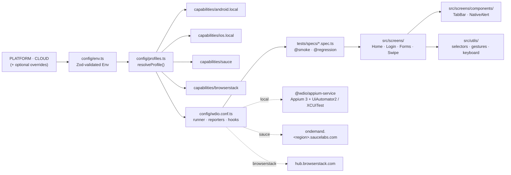
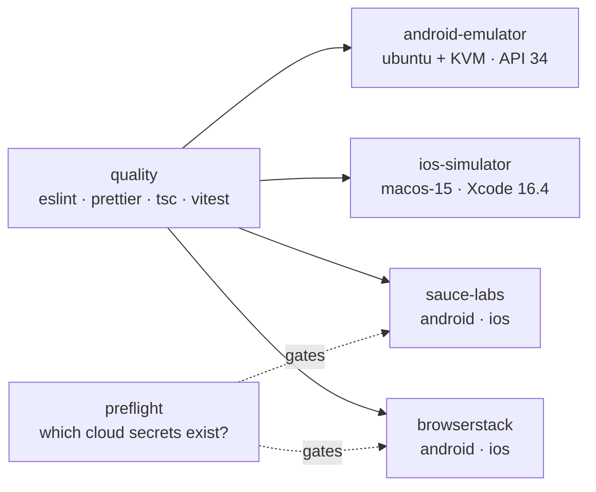

# appium-mobile-cloud

[](https://github.com/yassineaitt/appium-mobile-cloud/actions/workflows/ci.yml)
[](https://appium.io)
[](https://webdriver.io)
[](https://www.typescriptlang.org/)
[](.nvmrc)
[](LICENSE)

One mobile test framework, three execution targets. The same iOS and Android suites run on a
**local emulator/simulator**, on **Sauce Labs** or on **BrowserStack** real devices, selected by
two environment variables:

```bash
PLATFORM=android CLOUD=local        npm test
PLATFORM=ios     CLOUD=local        npm test
PLATFORM=android CLOUD=sauce        npm test     # needs SAUCE_USERNAME / SAUCE_ACCESS_KEY
PLATFORM=ios     CLOUD=browserstack npm test     # needs BROWSERSTACK_* secrets
```

System under test: the open-source
[WebdriverIO native demo app](https://github.com/webdriverio/native-demo-app) (React Native),
downloaded at run time from its GitHub release and verified against pinned SHA-256 checksums.
Binaries are never committed.

## Why TypeScript + WebdriverIO (and not Python)

- **One language with the web stack.** Teams I work with run Playwright or WebdriverIO for web;
  sharing TypeScript, ESLint rules, fixtures style and CI templates removes a whole toolchain.
- **First-class Appium integration.** `@wdio/appium-service` manages the server lifecycle,
  `browser.swipe` and friends implement W3C gestures portably, and the type definitions for
  `appium:*` capabilities catch typos at compile time.
- **Cloud services are maintained by the vendors** (`@wdio/sauce-service`, BrowserStack SDK),
  so job naming, status reporting and tunnels are a config line, not custom code.
- The Python client is excellent for pure-Appium shops; here, consistency with the rest of the
  portfolio won.

## Architecture



**Rule:** screens and specs are cloud-agnostic. The word "Sauce" or "BrowserStack" appears only
under `config/` and in CI.

## Device matrix

| Target                   | Where it runs                 | Device(s)                                       | Trigger                           |
| ------------------------ | ----------------------------- | ----------------------------------------------- | --------------------------------- |
| `local` · Android        | GitHub `ubuntu-latest` + KVM  | Pixel 6 AVD, API 34, x86_64 (Google APIs)       | every push / PR                   |
| `local` · iOS            | GitHub `macos-15`, Xcode 16.4 | newest available iPhone 16 simulator (iOS 18.x) | every push / PR                   |
| `sauce` · Android        | Sauce Labs real device cloud  | `Google Pixel.*` (regex, first free unit)       | only when `SAUCE_*` secrets exist |
| `sauce` · iOS            | Sauce Labs real device cloud  | `iPhone.*`                                      | + `SAUCE_IOS_APP` (signed .ipa)   |
| `browserstack` · Android | BrowserStack App Automate     | Google Pixel 8 · Android 14                     | only when `BROWSERSTACK_*` exist  |
| `browserstack` · iOS     | BrowserStack App Automate     | iPhone 15 · iOS 17                              | + `BROWSERSTACK_IOS_APP`          |

Every device/OS value is an environment variable (see `.env.example`), so a matrix row is a
one-line change in CI, not a code change.

## Quick start (local)

```bash
nvm use && npm ci
npm run apps:download        # apps/ ← apk + simulator .app, checksum verified
npm run appium:setup         # drivers into ./.appium (APPIUM_HOME is project-local)
npm run appium:doctor        # verifies ANDROID_HOME, Java, Xcode, simulators…

# Android: start any emulator (API 29+), then
PLATFORM=android npm test
# iOS: have Xcode + an iPhone simulator, then
PLATFORM=ios npm test

# selective runs
npm test -- --mochaOpts.grep @smoke
npm test -- --spec tests/specs/login.spec.ts
```

Outputs land in `reports/`: `junit/*.xml` (one file per profile), `screenshots/` for failures,
and `appium-<platform>.log`.

## Real-device clouds

1. Upload the app once and keep the reference as a secret:

   ```bash
   CLOUD=sauce        npm run apps:upload   # prints SAUCE_ANDROID_APP=storage:<id>
   CLOUD=browserstack npm run apps:upload   # prints BROWSERSTACK_ANDROID_APP=bs://<id>
   ```

2. Add repository secrets: `SAUCE_USERNAME`, `SAUCE_ACCESS_KEY`, `BROWSERSTACK_USERNAME`,
   `BROWSERSTACK_ACCESS_KEY`, `BROWSERSTACK_ANDROID_APP` (and the iOS variants once you have a
   signed `.ipa`; the simulator build cannot run on real hardware).
3. That is all. The `preflight` job detects which secrets exist and the cloud jobs appear in the
   run; without secrets they are skipped, never failed.

Credentials are read from the environment only. `.env` is gitignored, `.env.example` documents
every variable, and a unit test asserts that no credential ever ends up inside capabilities.

## CI pipeline



- The AVD is cached between runs; a cold run creates the snapshot once.
- iOS picks the newest available iPhone 16 simulator at run time, pre-boots it and pins its UDID,
  so Xcode image updates on the runner never break the job.
- Every job uploads `reports/` (JUnit, screenshots, Appium log) as an artifact, pass or fail.
- `workflow_dispatch` takes a `grep` input for `@smoke`-only runs.

## Flaky-test mitigation on real devices

Real devices add sources of nondeterminism that emulators hide. What this framework does about them:

| Risk                                    | Mitigation in this repo                                                                                |
| --------------------------------------- | ------------------------------------------------------------------------------------------------------ |
| Slow cold starts, WDA compilation       | Long, explicit `wdaLaunchTimeout`, `uiautomator2ServerInstallTimeout`, `connectionRetryTimeout`        |
| Animations and keyboard races           | `disableWindowAnimation`, `hideKeyboard()` before every tap that follows typing                        |
| Element found before it is interactable | Screens wait on `waitForDisplayed`; assertions use `expect(...).toBeDisplayed()` which retries         |
| Specific device busy / unavailable      | Sauce device names are regexes; BrowserStack falls back within the OS version                          |
| App state leaking between tests         | Full reinstall per session (`noReset` off); carousel/dropdown tests re-enter their tab in `beforeEach` |
| One-off infrastructure blips            | `specFileRetries: 1` in CI only, with deferred retries so a flaky file does not block the run          |
| Silent failures on cloud dashboards     | Session status is pushed back (`@wdio/sauce-service`, `browserstack_executor`) per test                |
| Debuggability                           | Screenshot per failed test, Appium server log, cloud video/network logs enabled                        |

What it deliberately does **not** do: blanket retries at the test level, `pause()` sprinkled in
specs, or XPath selectors. A test that needs those is a test that needs fixing.

## Project layout

```
.
├── .github/workflows/ci.yml       quality · preflight · android-emulator · ios-simulator · sauce-labs · browserstack
├── apps/manifest.json             pinned release URLs + SHA-256 (binaries are downloaded, not committed)
├── config/
│   ├── env.ts                     Zod schema for every variable
│   ├── profiles.ts                PLATFORM + CLOUD → capabilities, host, services
│   ├── capabilities/              android.local · ios.local · sauce · browserstack
│   └── wdio.conf.ts               single runner config
├── scripts/                       download-apps.sh · upload-apps.sh
├── src/
│   ├── screens/                   home · login · forms · swipe (+ components/)
│   ├── utils/                     selectors · gestures · keyboard
│   └── data/                      users and expected messages
└── tests/
    ├── specs/                     device tests (@smoke / @regression)
    └── unit/                      Vitest: env parsing and profile resolution
```

## Contributing

See [CONTRIBUTING.md](CONTRIBUTING.md).

## License

[MIT](LICENSE) © Yassine Ait Tamarmoucht
